# 🌱 Chatla (شتلة)

> A modern digital marketplace connecting plant enthusiasts, landscapers, and urban gardeners with local plant nurseries across Morocco.

[](https://www.php.net/)
[](https://laravel.com/)
[](https://tailwindcss.com/)
[](https://alpinejs.dev/)
[](https://www.docker.com/)
[](https://opensource.org/licenses/MIT)

---

## 📸 Demo & Screenshots

### 🌿 Public Botanical Discovery & Directory
| 01. Landing Page (Hero & Highlights) | 02. Explore Botanical Catalog |
|:---:|:---:|
| 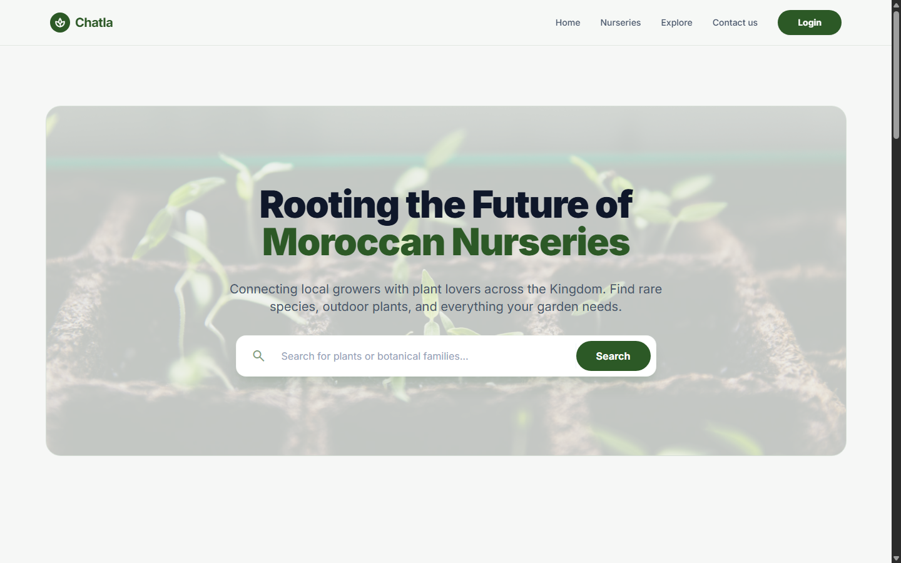 | 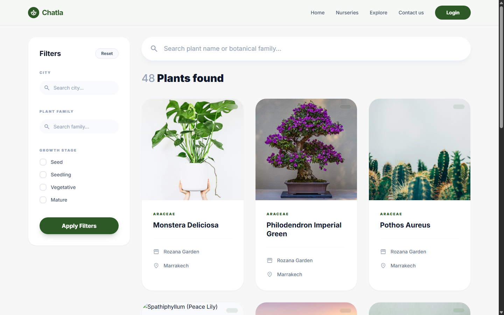 |

| 03. Moroccan Nurseries Directory | 04. Single Nursery Profile & Catalog |
|:---:|:---:|
| 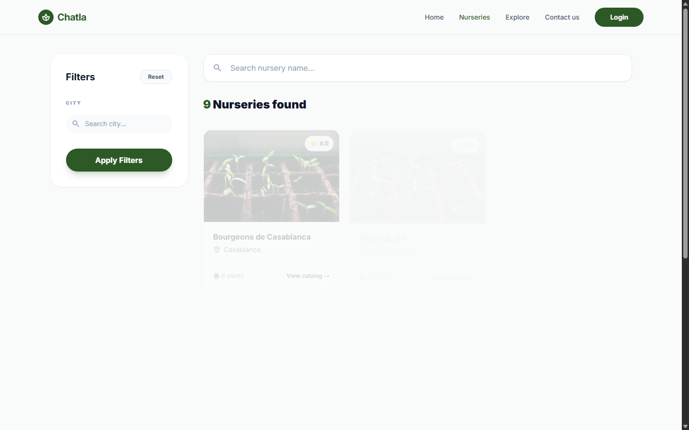 | 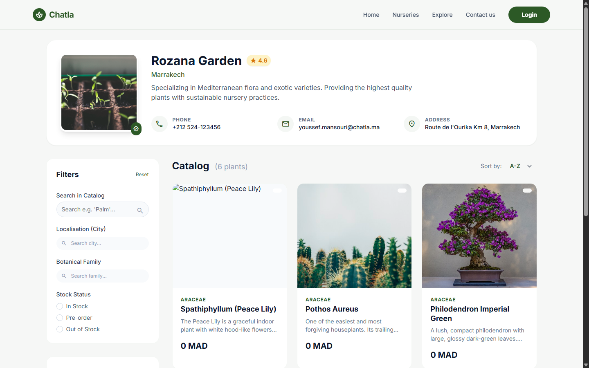 |

| 05. Plant Care & Price Specifications | 06. Contact & Partnership Inquiries |
|:---:|:---:|
| 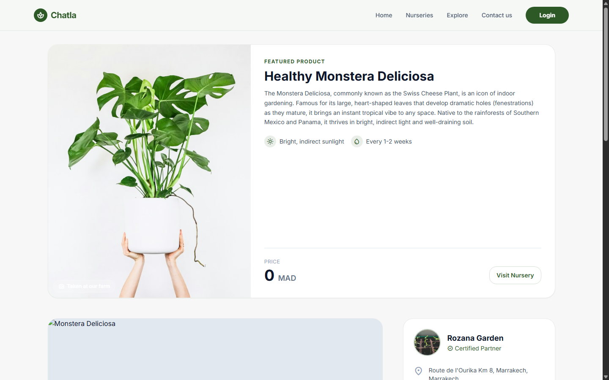 | 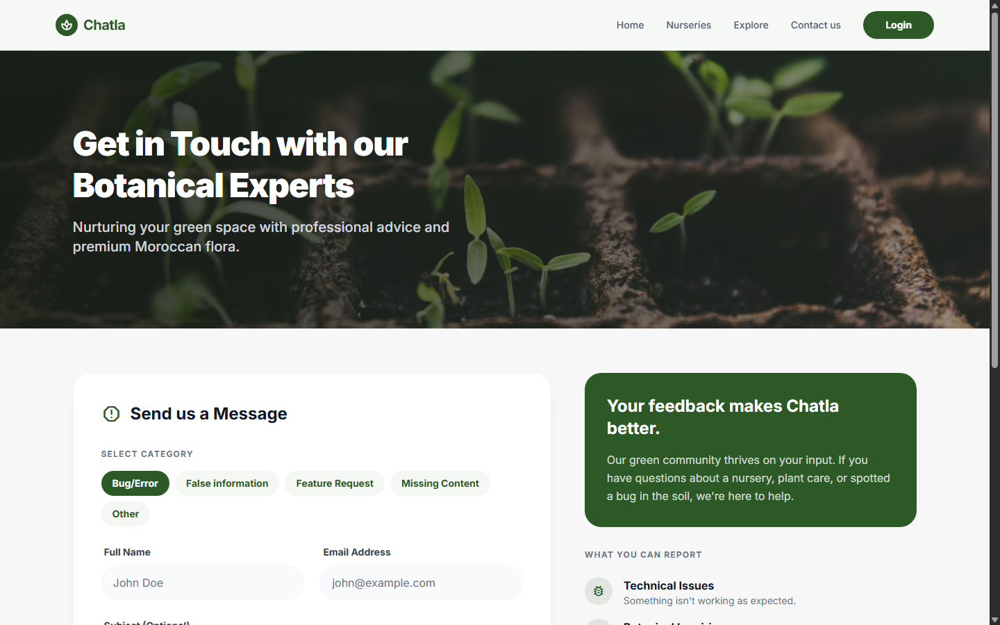 |

### 🔒 Nursery Owner Operations & Admin Governance
| 09. Nursery Owner Metrics Dashboard | 10. Nursery Inventory & Stock Controls |
|:---:|:---:|
| 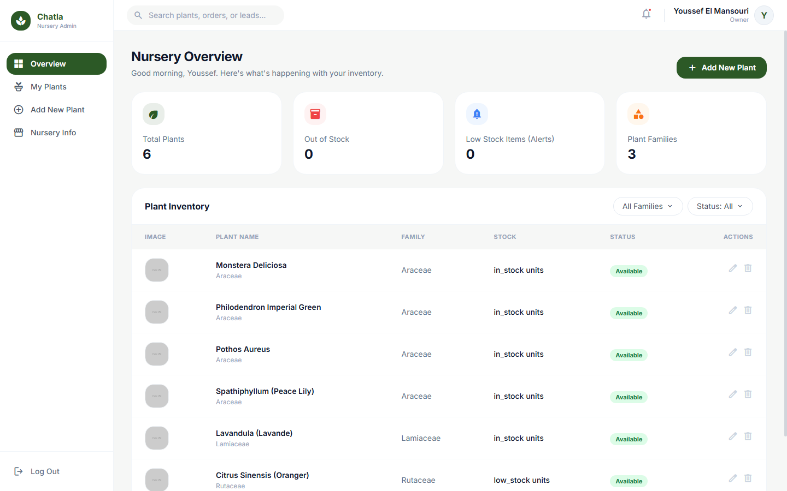 | 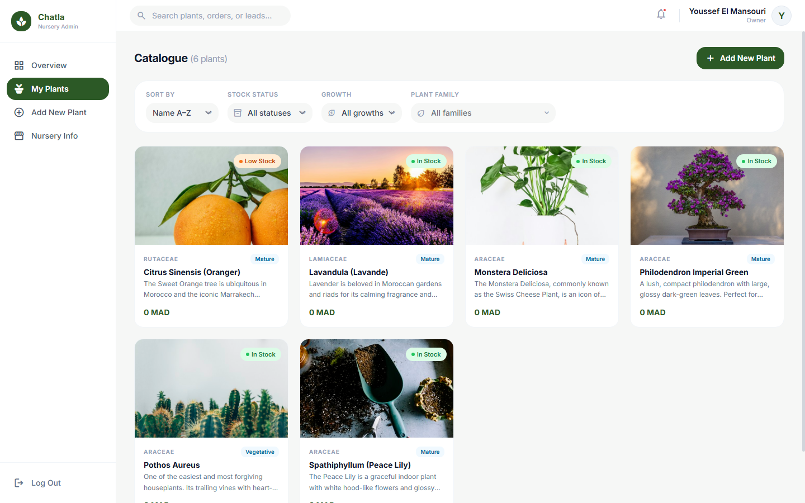 |

| 12. Nursery Geolocation & Profile Settings | 13. Platform Administrator Dashboard |
|:---:|:---:|
| 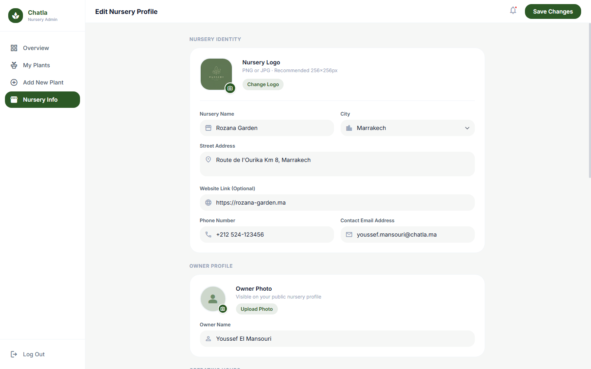 | 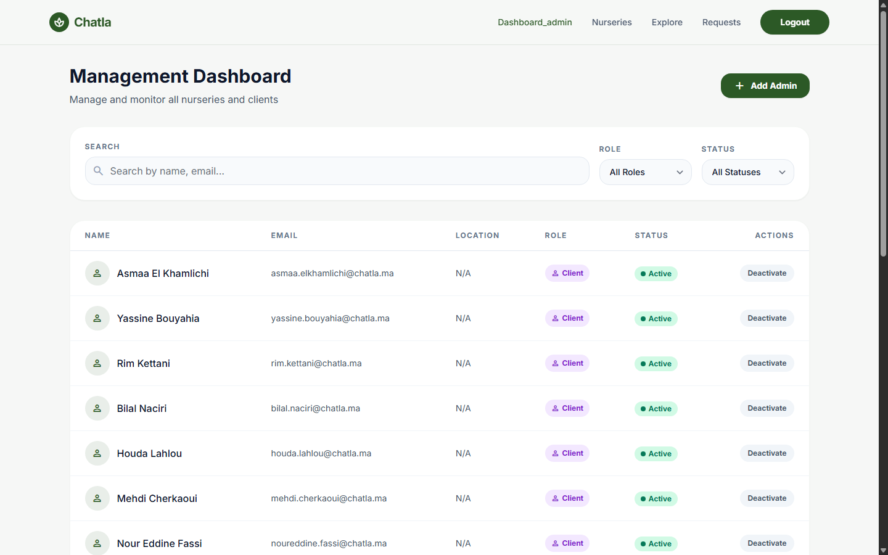 |

---

## 🚀 Key Features

- **Multi-Criteria Botanical Discovery:** Real-time search across species, scientific names, Moroccan plant families, growth stages (`seed`, `seedling`, `vegetative`, `mature`), and geographic regions.
- **Comprehensive Plant Care Cards:** Every botanical listing features verified environmental requirements: sunlight exposure, watering frequency, temperature tolerances, pet toxicity, leaf care, and climbing support.
- **Moroccan Nursery Network:** Interactive directory mapping active nurseries across Moroccan regions (Casablanca, Rabat, Marrakech, Tangier, Fès, Agadir) with opening hours, contact details, and geolocation coordinates.
- **Nursery Owner Management Suite:**
  - Dedicated operations dashboard with live KPI counters (total species, out-of-stock items, low stock alerts, botanical families represented).
  - Granular inventory control: update stock units, adjust pricing in Moroccan Dirhams (MAD), define custom nursery care advice, and upload item photos.
  - Nursery branding and location editor with interactive map positioning.
- **Community Ratings & Reviews:** Verified simple users can leave 1-to-5 star ratings and reviews on nurseries to encourage trust and quality.
- **Platform Governance & Moderation:**
  - Administrative control center to review and approve newly registered nursery accounts (`pending` $\rightarrow$ `active` $\rightarrow$ `suspended`).
  - Request and report resolution pipeline for customer inquiries, partnerships, and bug reports.
- **RESTful API Backend:** High-performance JSON endpoints for plant queries, advanced growth filters, and inventory synchronization.
- **Zero-Friction Containerized Deployment:** Production-grade Docker multi-stage build bundling PHP 8.4 runtime, Vite-compiled assets, and seeded SQLite database.

---

## 🛠 Tech Stack

| Layer | Technology | Purpose |
|---|---|---|
| **Backend Framework** | **Laravel 13 (PHP 8.4)** | RESTful controllers, Eloquent ORM, custom authentication middleware, database migrations & seeders |
| **Frontend Architecture** | **Blade & Tailwind CSS** | Server-rendered responsive UI with atomic utility styling and dark-mode support |
| **Client-Side Interactivity** | **Alpine.js 3.x** | Reactive UI components, dynamic modals, and client-side interactions |
| **Asset Pipeline** | **Vite 8 & PostCSS** | Rapid frontend bundling with Rollup and CSS minification |
| **Mapping & Geolocation** | **Leaflet.js** | Open-source interactive maps for nursery geographic coordinate selection |
| **Database Tier** | **SQLite 3** | Zero-configuration relational database with foreign key enforcement and transactional integrity |
| **Containerization** | **Docker & Docker Compose** | Multi-stage container build isolating frontend compiling from the PHP 8.4 CLI server |
| **Automated Testing** | **PHPUnit 12 & Playwright** | Unit/feature backend tests and automated end-to-end browser regression screenshot suite |

---

## 🏛 Architecture & Diagrams

### System Architecture
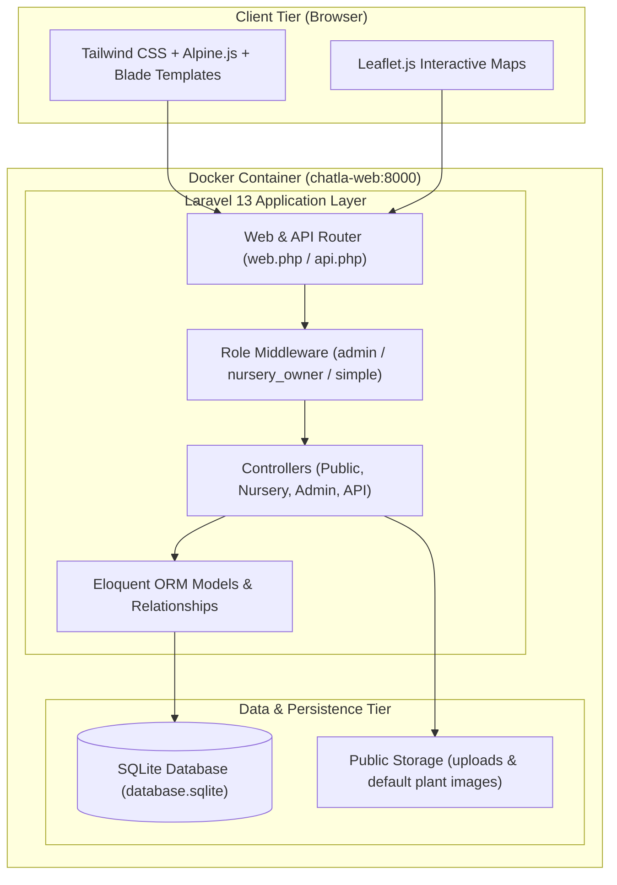

### Entity-Relationship Diagram (ERD)
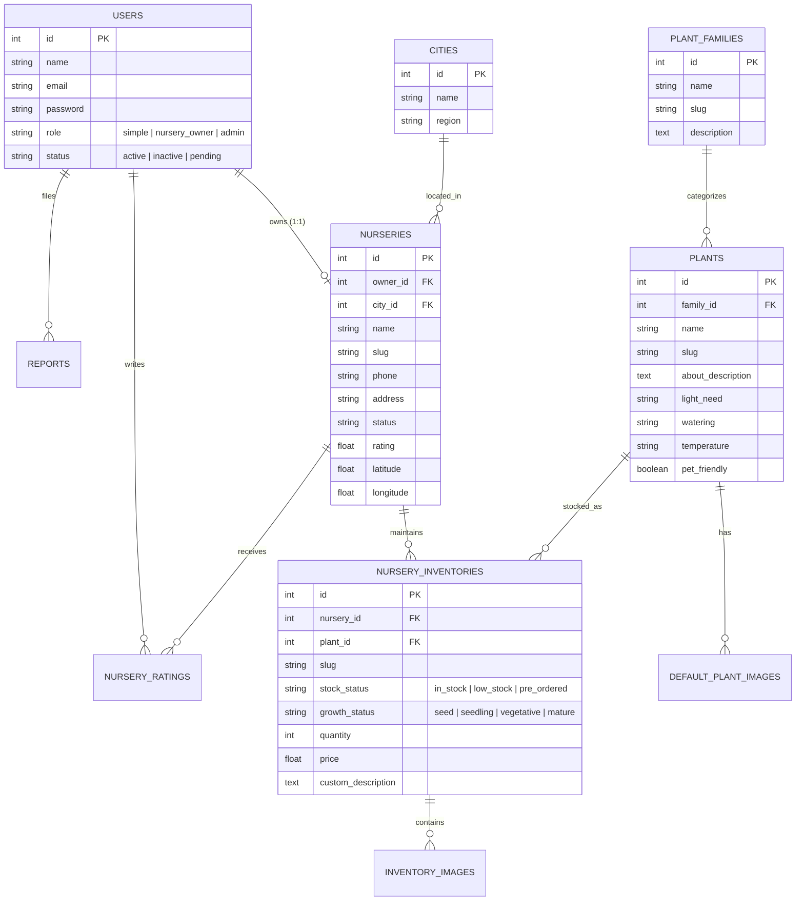

### Main User Flow (Discovery & Inventory Inquiry)
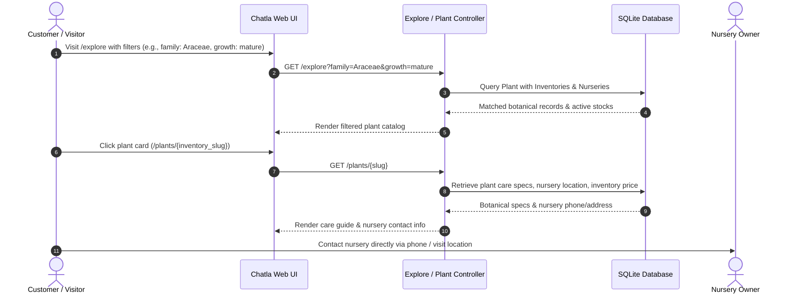

---

## 🚦 Getting Started

### Prerequisites
- [Docker](https://www.docker.com/) and Docker Compose (recommended).
- Alternatively for bare-metal host execution:
  - **PHP 8.4+** with extensions: `pdo_sqlite`, `bcmath`, `zip`, `mbstring`, `curl`
  - **Composer 2.x**
  - **Node.js 22+** & **npm**

### Quickstart with Docker (Recommended)
Clone the repository and launch the container with a single command:

```bash
# 1. Clone the repository
git clone https://github.com/sabri-rihab/Chatla.git
cd Chatla

# 2. Build and start the container
docker compose up --build -d
```

The container automatically:
1. Compiles frontend assets with Vite & Tailwind CSS.
2. Configures `.env` with a generated application key (`APP_KEY`).
3. Runs all migrations and seeds Moroccan cities, 15 plant families, 27 detailed plants, 10 nurseries, 50+ inventories, and 42 ratings.
4. Creates public storage symlinks.
5. Serves the application at **`http://localhost:8000`**.

To view live container logs:
```bash
docker logs -f chatla-web
```

To stop the container:
```bash
docker compose down
```

---

### Manual Setup (Without Docker)

```bash
# 1. Navigate into application folder
cd Chatla

# 2. Setup environment file
cp .env.example .env

# 3. Install PHP dependencies
composer install

# 4. Generate encryption key
php artisan key:generate

# 5. Initialize database & seed demo data
touch database/database.sqlite
php artisan migrate:fresh --seed

# 6. Install Node dependencies & build assets
npm install
npm run build

# 7. Link storage & start local server
php artisan storage:link
php artisan serve --port=8000
```

---

## 🔑 Default Accounts & Credentials

The database seeder automatically provisions test accounts for every platform role (all default passwords are `password`):

| Role | Email | Password | Access Level |
|---|---|---|---|
| **Platform Administrator** | `admin@chatla.ma` | `password` | `/admin/dashboard` & `/admin/requests` (user approvals, moderation) |
| **Nursery Owner** | `youssef.mansouri@chatla.ma` | `password` | `/dashboard`, `/nursery/plants`, `/nursery/profile` |
| **Simple User (Client)** | `imane.benkirane@chatla.ma` | `password` | Public views, nursery reviews & rating submissions |

---

## 📂 Project Structure

```
Chatla/
├── Chatla/                           # Core Laravel 13 Application
│   ├── app/
│   │   ├── Http/Controllers/         # Web & API controllers
│   │   │   ├── Admin/                # AdminDashboardController (moderation & requests)
│   │   │   ├── Api/                  # PlantController & NurseryController (REST endpoints)
│   │   │   ├── Auth/                 # Authentication & Breeze controllers
│   │   │   └── PublicPlantController.php # Public discovery & care sheet controllers
│   │   └── Models/                   # Eloquent models (Plant, Nursery, NurseryInventory, etc.)
│   ├── config/                       # Application, session, and database configurations
│   ├── database/
│   │   ├── migrations/               # 20 database migrations
│   │   └── seeders/                  # Production seeders (User, City, Plant, Nursery, Ratings)
│   ├── public/                       # Static web root & compiled Vite assets
│   ├── resources/
│   │   ├── css/ & js/                # Tailwind CSS entrypoint & Alpine.js initialization
│   │   └── views/                    # Blade templates (admin, nursery, public, auth)
│   ├── routes/
│   │   ├── api.php                   # Public & protected REST endpoints
│   │   ├── web.php                   # Frontend routes & middleware pipelines
│   │   └── auth.php                  # Authentication routes
│   ├── composer.json                 # PHP package declarations (Laravel 13, PHP 8.4)
│   └── package.json                  # Node dependencies (Vite 8, Tailwind CSS, Alpine.js)
├── docs/                             # Documentation assets
│   ├── api-examples.md               # Complete REST API reference with real JSON responses
│   └── screenshots/                  # 14 high-resolution desktop interface captures
├── scripts/                          # Automation scripts
│   ├── screenshots.js                # Reusable Playwright screenshot regression script
│   └── package.json                  # Playwright dependencies
├── docker-compose.yml                # Docker Compose orchestration file
├── Dockerfile                        # Multi-stage production container build (Node + PHP 8.4)
├── .dockerignore                     # Docker build exclusions
├── .env.example                      # Root environment configuration blueprint
└── README.md                         # Portfolio documentation
```

---

## 📡 API Reference & Usage

Chatla provides public and protected RESTful endpoints. See [`docs/api-examples.md`](docs/api-examples.md) for full cURL examples and JSON response schemas.

| Method | Endpoint | Access | Description |
|---|---|---|---|
| `GET` | `/api/plants/search?name={name}&family={family}` | Public | Search plant catalog by partial species or botanical family |
| `GET` | `/api/plants/search/advanced?name={name}&growth={stage}` | Public | Filter plants by growth stage (`seed`, `seedling`, `vegetative`, `mature`) |
| `GET` | `/api/plants/search/location?city={city}` | Public | Find plant species stocked by nurseries in a given Moroccan city |
| `GET` | `/api/plants/{id}` | Public | Full botanical care instructions, environmental specs, and nursery stocks |
| `POST` | `/api/plants` | Nursery Owner | Add plant species, stock level, MAD price, and notes to nursery inventory |
| `DELETE` | `/api/plants/{id}?confirm=1` | Nursery Owner | Remove an inventory entry from nursery stock (guarded by `?confirm=1`) |

---

## 📊 Dataset & Seed Metrics

The application includes an authentic dataset modeling the Moroccan nursery sector:

- **10 Registered Moroccan Nurseries:** Distributed across Casablanca, Rabat, Marrakech, Tangier, Salé, and Agadir.
- **27 Curated Botanical Species:** From classic indoor flora (*Monstera Deliciosa*, *Ficus Benjamina*, *Epipremnum Aureum*) to endemic Moroccan species (*Argania Spinosa*, *Phoenix Dactylifera*, *Ceratonia Siliqua*, *Opuntia*).
- **15 Plant Families:** Complete botanical classifications including *Araceae*, *Moraceae*, *Arecaceae*, *Cactaceae*, *Lamiaceae*, and *Rosaceae*.
- **50+ Real Inventory Entries:** Realistic inventory levels, growth stage distributions, and pricing in Moroccan Dirhams (MAD).
- **42 Authenticated Nursery Ratings:** Genuine user feedback, star ratings, and community reviews.

---

## 💡 Engineering Challenges & Learnings

1. **Composite Inventory Slugging & Routing:**
   In an e-commerce nursery directory, multiple nurseries carry the same plant species (*Monstera Deliciosa*). To support search-engine-friendly URLs without conflicts, `NurseryInventory` uses a dynamic composite slug generator (`{plant-name}-at-{nursery-name}-{id}`) while maintaining Eloquent route-model binding.

2. **Container Multi-Staging with Modern Frontend Tooling:**
   Laravel 13 and Symfony 8 dependencies require PHP 8.4+, while modern Vite 8 with PostCSS requires Node 22+. To keep the final deployment lean and avoid polluting the production container with Node runtime overhead, a two-stage Docker build was engineered: Stage 1 compiles frontend assets; Stage 2 injects the compiled bundles into a minimal PHP 8.4 Bookworm runtime.

3. **Graceful Image Fallback Hierarchy:**
   Plant inventory records can have nursery-uploaded custom photos, plant-level default photography, or generic botanical placeholders. An Eloquent accessor `getDisplayImageAttribute()` implements an automated 3-tier fallback hierarchy ensuring no broken images ever appear on customer-facing cards.

4. **Role-Based Status Governance:**
   Nursery owners require platform vetting prior to listing stock publicly. Custom middleware chains (`auth`, `verified`, `nursery_owner`, `admin`) govern user status transitions (`pending` $\rightarrow$ `active` $\rightarrow$ `inactive`), ensuring inactive nursery inventory is systematically filtered out from public search results.

---

## 🔮 Future Improvements

- [ ] **Direct Customer Messaging & Quotations:** Real-time WebSocket chat between buyers and nursery managers for wholesale order negotiations.
- [ ] **AI-Powered Plant Disease Diagnostic:** Mobile photo upload integrating computer vision to identify leaf blight, under-watering, or pest infestations.
- [ ] **Moroccan Online Payment Gateway:** Integration with CMI (Centre Monétique Interbancaire) for direct in-app order checkout and delivery dispatch.
- [ ] **Multi-Language Localization:** Full Arabic (العربية) and French (Français) bilingual interface toggle.

---

## 👤 Author

**Rihab Sabri**  
- **GitHub:** [@sabri-rihab](https://github.com/sabri-rihab)  
- **LinkedIn:** [linkedin.com/in/rihab-sabri](https://www.linkedin.com/in/rihab-sabri-497281245/)  
- **Portfolio:** [Portfolio Link](https://github.com/sabri-rihab)
